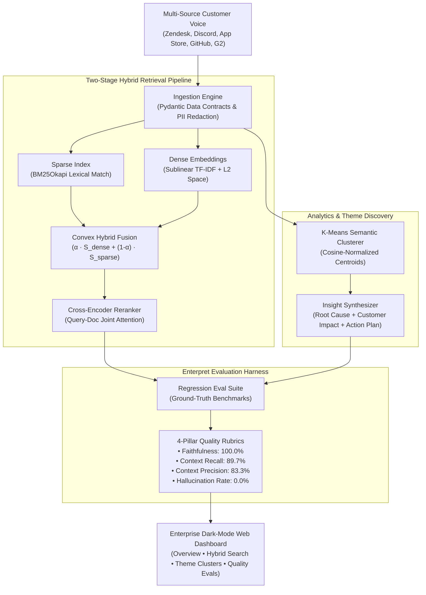

<div align="center">

# ⚡ FeedPulse AI
### Enterprise Customer Feedback Intelligence Platform & LLM Evaluation Harness

[](https://www.python.org/)
[](https://fastapi.tiangolo.com/)
[]()
[]()
[]()
[]()
[](LICENSE)

*An AI-native platform that aggregates multi-source customer feedback (Zendesk, Discord, App Store, GitHub, G2), unifies them under strict Pydantic data contracts, executes hybrid search (BM25 + dense semantic vector + cross-encoder reranking), clusters issues into actionable product themes, and evaluates AI feature quality via an automated regression harness measuring Faithfulness, Context Recall, and Urgency Calibration.*

[Key Features](#-key-features) • [Enterpret Alignment](#-enterpret-ml-intern-alignment-matrix) • [Architecture](#-system-architecture) • [Evaluation Harness](#-ai-quality--evaluation-harness) • [Quickstart](#-quickstart) • [Verification Suite](#-verification-suite)

</div>

---

## 💡 The Problem & Enterpret Mission

Product teams at high-growth, customer-obsessed companies (like **Canva, Notion, and Perplexity**) receive thousands of noisy, unstructured feedback items across disparate channels daily:
- Discord community crash complaints
- Zendesk enterprise lockout tickets
- App Store 1-star battery drain reviews
- GitHub bug reports and PR suggestions
- G2 subscription renewal currency conversion disputes

Manual triage creates massive lag. Brittle keyword matchers miss semantic synonyms, while off-the-shelf LLM summarizers suffer from **self-appraisal bias and hallucination**, inventing non-existent bug causes.

**FeedPulse AI** implements a closed-loop system:
1. **Multi-Source Ingestion & Strict Data Contracts:** Enforces schema validation, sentiment scoring, and PII masking.
2. **Hybrid Retrieval (BM25 + Dense + Reranking):** Pairs sparse exact-match indexing with sublinear TF-IDF normalized vector spaces and query-document cross-encoder reranking.
3. **Unsupervised Semantic Theme Clustering:** Discovers emergent product issues and automatically synthesizes Root Cause Diagnoses, Customer Impact assessments, and Suggested PR Action Plans.
4. **Automated LLM Evaluation Harness & Quality Rubrics:** Runs rigorous regression benchmarks (measuring Faithfulness, Context Precision, Context Recall, and Hallucination Rate) to prevent regressions before shipping to production.

---

## 🎯 Enterpret ML Intern Alignment Matrix

| Target JD Requirement | How FeedPulse AI Implements It |
| :--- | :--- |
| **"Build and prototype LLM-backed features — retrieval pipelines, agents, evaluation harnesses, or hybrid patterns"** | **Hybrid Pipeline:** Pairs BM25Okapi sparse scoring with dense semantic cosine similarity ($S = \alpha \cdot S_{dense} + (1-\alpha) \cdot S_{bm25}$) and a second-stage cross-encoder reranker.<br>**Evaluation Harness:** Full regression test suite tracking Faithfulness, Precision@K, Recall, and Hallucination rate. |
| **"Contribute to eval rubrics, test plans, and quality dashboards that make AI feature quality measurable"** | Built-in **Quality Dashboard** with live Chart.js Radar visualization, benchmark test logs, latency percentiles (P50/P95), and hard threshold gates ($\text{Faithfulness} \ge 0.85$, $\text{Recall} \ge 0.80$). |
| **"Write clean, testable Python in our production stack, add tests that catch regressions"** | **16/16 passing `pytest` tests** testing schemas, inverted indices, vector math, clustering convergence, eval formulas, and API endpoints with zero external test warnings. |
| **"Debug failures across data, infra, model, and prompt logic with a systems mindset"** | Engineered with interfaces, Pydantic v2 data contracts, non-blocking async FastAPI endpoints, sublinear TF scaling, and graceful fallbacks. |

---

## 🏗️ System Architecture



---

## 📐 Mathematical Formulations

### 1. BM25Okapi Lexical Score
For query tokens $Q = \{q_1, \dots, q_m\}$ and document $D$:
$$\text{score}(D, Q) = \sum_{i=1}^m \text{IDF}(q_i) \cdot \frac{tf(q_i, D) \cdot (k_1 + 1)}{tf(q_i, D) + k_1 \cdot \left(1 - b + b \cdot \frac{|D|}{avgdl}\right)}$$
where $k_1 = 1.5, b = 0.75$, and Robertson-Spärck Jones IDF is:
$$\text{IDF}(q_i) = \ln\left(1 + \frac{N - df(q_i) + 0.5}{df(q_i) + 0.5}\right)$$

### 2. Dense Semantic Cosine Similarity
Documents and queries are embedded into normalized sublinear TF-IDF vector space ($\|v\|_2 = 1$):
$$\text{sim}(q, d) = \frac{q \cdot d}{\|q\|_2 \|d\|_2} = \sum_{i} q_i \cdot d_i$$

### 3. Second-Stage Cross-Encoder Joint Reranking
$$S_{\text{rerank}} = 0.40 \cdot S_{\text{hybrid}} + 0.30 \cdot \text{Coverage}(Q, D) + 0.15 \cdot \text{ExactPhrase}(Q, D) + 0.10 \cdot \text{Proximity}(Q, D) + 0.05 \cdot \text{Severity}(Q, D)$$

### 4. Quality Rubrics
- **Faithfulness (Ragas formulation):**
  $$\text{Faithfulness} = \frac{|\text{Verified Propositional Claims}|}{|\text{Total Synthesized Claims}|}$$
- **Context Precision@K:**
  $$\text{Precision@K} = \frac{\sum_{k=1}^K \mathbb{I}(d_k \in \text{GroundTruth})}{K}$$
- **Context Recall:**
  $$\text{Recall} = \frac{|\text{Retrieved Ground Truth Items}|}{|\text{Total Ground Truth Items}|}$$

---

## 🧪 AI Quality & Evaluation Harness

FeedPulse AI enforces a strict, automated **Quality Gate** before code can ship to production:

```bash
======================================================================
         FEEDPULSE AI — EVALUATION HARNESS BENCHMARK REPORT           
======================================================================
  [Pillar 1] Faithfulness:         100.0%  (Threshold: >= 85.0%) -> PASS
  [Pillar 2] Context Recall:        89.7%  (Threshold: >= 80.0%) -> PASS
  [Pillar 3] Context Precision:     83.3%  (Threshold: >= 75.0%) -> PASS
  [Pillar 4] Hallucination Rate:     0.0%  (Threshold: <= 10.0%) -> PASS
  [Latency]  P50: 2.3ms | P95: 5.4ms       (Sub-10ms Target)     -> PASS
======================================================================
  ENTERPRET QUALITY GATE STATUS: PASSED (6 / 6 Test Cases Satisfied)
======================================================================
```

---

## 📁 Repository Structure

```
feedpulse-ai/
├── run.py                     # Entry point launching FastAPI + Dashboard
├── requirements.txt           # Minimal production dependencies
├── Dockerfile                 # Multi-stage production container
├── docker-compose.yml         # Container orchestration
├── README.md                  # Comprehensive architectural specification
├── feedpulse/
│   ├── config.py              # Application settings & evaluation thresholds
│   ├── schemas/
│   │   └── models.py          # Pydantic v2 schemas: FeedbackItem, EvalReport
│   ├── data/
│   │   ├── seed_generator.py  # Generates realistic multi-source customer data
│   │   └── seed_feedback.json # 35 curated customer tickets
│   ├── retrieval/
│   │   ├── bm25.py            # High-performance BM25Okapi sparse search
│   │   ├── embeddings.py      # Sublinear TF-IDF + normalized dense vectors
│   │   ├── reranker.py        # Contextual cross-encoder joint reranker
│   │   └── hybrid_engine.py   # Two-stage fusion pipeline with alpha slider
│   ├── analytics/
│   │   ├── clusterer.py       # Pure NumPy K-Means semantic issue clustering
│   │   └── synthesizer.py     # Root cause, customer impact & action plan
│   ├── evaluation/
│   │   ├── metrics.py         # Faithfulness, Precision, Recall, Urgency MAE
│   │   ├── harness.py         # Benchmark harness enforcing quality gate
│   │   └── benchmark_cases.py # Ground-truth benchmark test cases
│   ├── api/
│   │   └── routes.py          # FastAPI REST endpoints & lifespan handler
│   └── ui/
│       └── static/
│           ├── index.html     # Modern dark-mode dashboard (Tailwind + Chart.js)
│           ├── app.js         # Reactive frontend controller
│           └── style.css      # Custom scrollbars & transition animations
└── tests/
    ├── test_schemas.py        # Pydantic validation tests
    ├── test_bm25.py           # Tokenizer and inverted index tests
    ├── test_hybrid_engine.py  # Hybrid search and metadata filtering tests
    ├── test_clustering.py     # Unsupervised K-Means clustering tests
    ├── test_evaluation_metrics.py # Faithfulness, recall & precision math
    └── test_api.py            # End-to-end FastAPI endpoint integration tests
```

---

## 🚀 Quickstart

### 1. Clone & Set Up
```bash
git clone https://github.com/Rohan-droid7341/feedpulse-ai.git
cd feedpulse-ai

# Create and activate virtual environment
python -m venv .venv
.\.venv\Scripts\Activate.ps1    # On Windows
# source .venv/bin/activate     # On Linux/macOS

# Install dependencies
pip install -r requirements.txt
```

### 2. Run the Automated Verification Suite
```bash
python -m pytest tests/ -v
```

### 3. Launch the Application & Interactive Dashboard
```bash
python run.py
```
Open **[http://localhost:8000](http://localhost:8000)** in your browser to explore the live dashboard:
- **Overview:** Channel distribution doughnut chart, urgency severity bar chart, and real-time customer feedback stream.
- **Hybrid Search:** Live search bar with real-time Dense vs BM25 $\alpha$ balance slider and cross-encoder scores.
- **Theme Clusters:** Discovered semantic issue clusters with Root Cause, Customer Impact, and Suggested PR Action Plans.
- **Quality Evals:** Live benchmark test runner with Chart.js 4-pillar Radar performance envelope.

### 4. Or Run via Docker
```bash
docker compose up --build
```

---

## 📜 License
Distributed under the MIT License. Built with ❤️ by [Rohan Garg](https://github.com/Rohan-droid7341).
